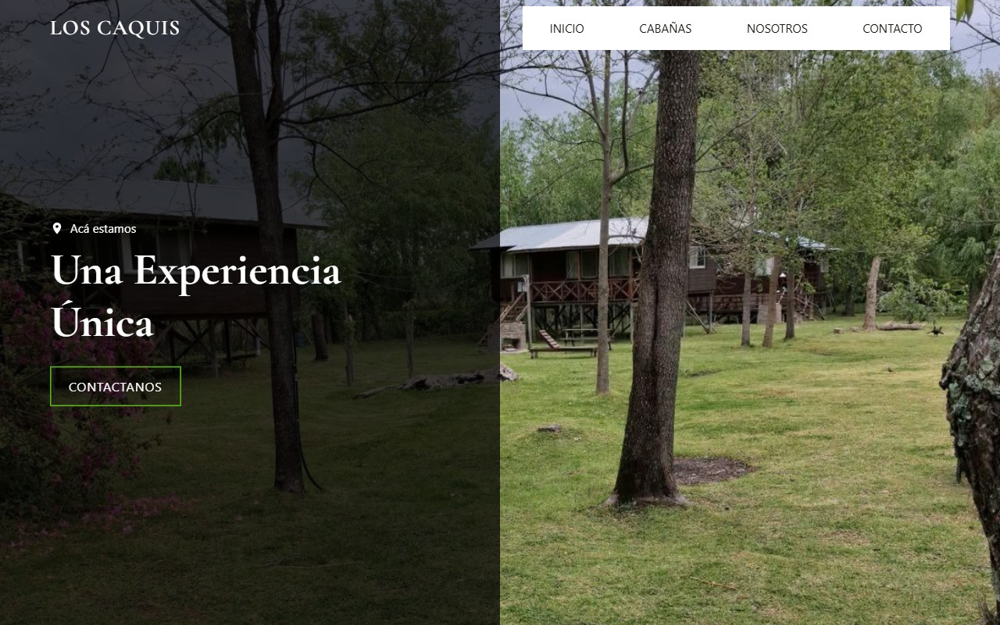
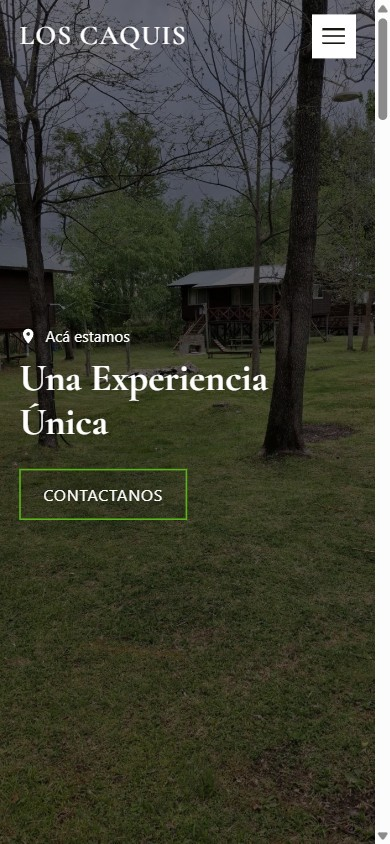

# Cabañas Los Caquis

Página de alquiler del complejo de cabañas de mi papá, en el Delta de Tigre. HTML, CSS y JavaScript a mano, con el código comentado línea por línea.

**Ver en vivo:** https://marcosaad.github.io/Caba-as-los-Caquis/

## Qué tiene
- Responsive y con animaciones al hacer scroll.
- Ventana de galería de fotos por cabaña.
- Formulario que arma el mensaje y lo envía por WhatsApp.
- Datos de configuración (WhatsApp, link de Maps, cabañas, reseñas) al inicio de `js/main.js`.

## Tecnologías
HTML, CSS y JavaScript sin librerías. Publicado con GitHub Pages.

## Cómo verlo localmente
Bajá el repo y abrí `index.html` en el navegador.

## Qué aprendí
- Capas de fondo en CSS (degradado + imagen + color de respaldo).
- Efecto parallax con `position: fixed` y `clip-path`.
- `IntersectionObserver` para animar elementos al aparecer.
- `<dialog>` nativo para las ventanas de fotos.
- Link de WhatsApp con `wa.me` y `encodeURIComponent`.
